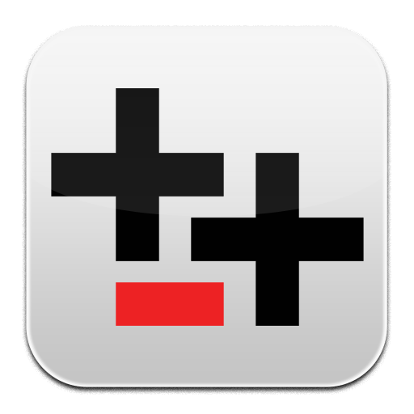

# Translator++ for Android

  

**Translator++** is the premier Computer-Aided Translation (CAT) tool for video games and visual novels, rewritten as a modern, high-performance Android application powered by Kotlin and Jetpack Compose with Material Design 3.

---

## Key Features

- **Multi-Engine Game Localization:**
  - Full project support for **RPG Maker (MV, MZ, XP, VX Ace)**, **Ren'Py Visual Novels**, **Wolf RPG Editor**, **Unity (XUnity_AutoTranslator)**, **TyranoScript**, and spreadsheet/JSON tables.
- **Context-Aware CAT Grid:**
  - Dual-pane source and translation table with real-time status tracking (*Untranslated*, *Draft*, *In Review*, *Approved*).
  - Speaker identification badges, event script context paths, and translator notes.
  - Color-coded priority tags (Red, Orange, Yellow, Green, Blue, Purple).
- **Control Code & Syntax Preservation (Code Escaping):**
  - Proprietary escaping algorithms shield game control codes (`\c[2]`, `\v[1]`, `\n`, `[player_name]`, `{b}...{/b}`, `<color=#ff0000>...</color>`) during machine translation and human review.
- **Batch Machine Translation:**
  - Automated batch translation pipeline with configurable request delay, batch size, and engine selector (DeepL, Google Translate, Gemini AI Localizer, Offline Neural TM).
- **Terminology & Translation Memory (TM):**
  - Dedicated Glossary manager organized by Character, Item, Skill, Location, and System categories.
  - One-tap "Apply Glossary / TM" to instantly populate recurring names and key terms across untranslated rows.
- **In-Game Dialogue Box Simulator:**
  - Interactive visual preview simulating in-game dialogue windows (Classic JRPG, Visual Novel, Modern Dark) with speaker nameplates and portrait frames.
  - Real-time word wrap detection and overflow prevention alerts with one-tap "Auto-wrap" formatting.
- **Translation Patch Export:**
  - Generates engine-ready translation patches in formatted JSON/CSV ready for direct injection or distribution.
- **NetCollab Multiplayer CAT:**
  - Decentralized local collaborative localization monitoring room codes, direct host IP sessions, and real-time active collaborator states.

---

## Technical Stack & Architecture

- **Platform:** Android (Min SDK 26, Target SDK 36, Compile SDK 36)
- **Language:** Kotlin 2.2 with JVM toolchain 21
- **UI Toolkit:** Jetpack Compose with Material Design 3 (M3)
- **Architecture:** MVVM (Model-View-ViewModel) with unidirectional reactive data flow (`StateFlow`, `combine`)
- **Build System:** Gradle 9.3.1 with Android Gradle Plugin (AGP) 9.1.1
- **Theme:** Dynamic dark workstation theme tailored for comfortable translation sessions

---

## License

This project is licensed under the terms of the GNU General Public License v3.0 (GPLv3). See [LICENSE](LICENSE) for details.
