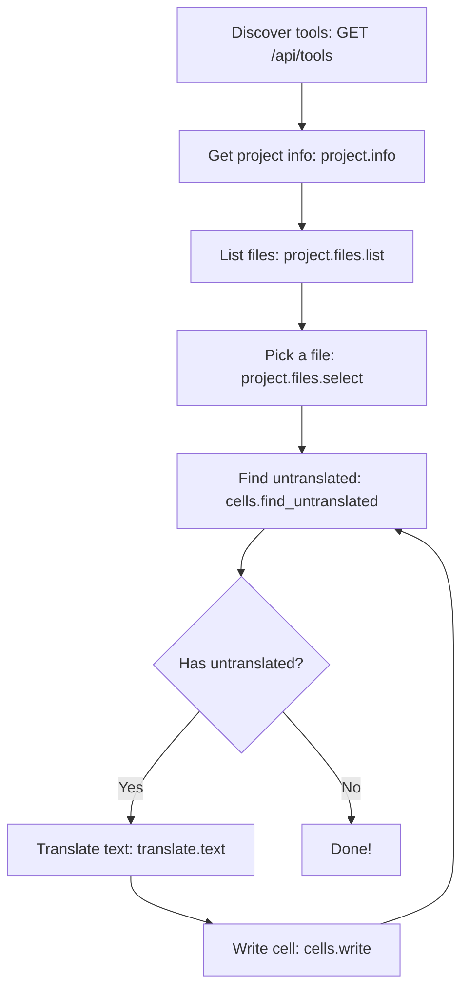

# AGENTS.md — Translator++ API Guide for AI Agents

This document describes how AI agents (Claude, Gemini, VS Code Copilot, etc.) can discover and control **Translator++** through its built-in HTTP JSON API.

## About Translator++

Translator++ is a tool for translating games. The application runs on **NW.js** in a mixed context of **Node.js and browser** APIs. The add-on system allows add-ons to interact with the application in various ways — add-ons are loaded via the `Addon` / `AddonLoader` implementation in `www/js/addon.js`. Scripts listed by the add-on are executed in an `AsyncFunction(...)` where **top-level `this` refers to the `Addon` instance**.

The HTTP API described below runs inside an addon (`basicUtils`) and has full access to the NW.js global scope — your scripts and tool handlers can call `trans.*`, `ui.*`, `sys.*`, `window`, and `nw` directly.

You can find additional guides in: `www/docs`

| Guide | Description |
|-------|-------------|
| `www/docs/trans.md` | Full `trans.project` data structure reference, file object schema, cell metadata, special files |
| `www/docs/addon-developer-guide-ai.md` | How add-ons are loaded, `package.json` format, runtime model |
| `www/docs/parser-base-developer-guide-ai.md` | `ParserBase` API — text extraction, context, `registerString()`, `transData` |
| `www/docs/parser-developer-guide-ai.md` | Building parser add-ons — project creation, export/inject workflow |
| `www/docs/translatorengine-developer-guide-ai.md` | Building translation engines — `fetchTranslation()`, engine registration |
| `www/docs/translatorengine-escape-algorithms.md` | All escape algorithms (`hexPlaceholder`, `HTMLCloaking`, `XMLCloaking`, etc.) |
| `www/docs/automation.md` | CodeRunner automation — workspace types, `@form` UI generation |
| `www/docs/custom-parser-tpm-format.md` | Custom parser TPM format specification |

## Quick Start

The API server runs automatically when Translator++ launches with a project open:

- **Base URL:** `http://127.0.0.1:22883`
- **Transport:** HTTP JSON (no auth required — localhost only)
- **CORS:** Enabled for all origins

## API Overview

| Endpoint | Method | Purpose |
|----------|--------|---------|
| `/api/tools` | GET | Discover all available tools (AI-native function catalog) |
| `/api/call` | POST | Invoke a named tool with parameters |
| `/api/exec` | POST | Execute arbitrary JavaScript in the Translator++ environment |

---

## 1. Discovery — `GET /api/tools`

Returns a JSON catalog of all registered tools in OpenAI function-calling format.

**Response shape:**
```json
{
  "tools": [
    {
      "name": "project.info",
      "description": "Get metadata about the currently open translation project.",
      "parameters": { "type": "object", "properties": {...}, "required": [...] }
    }
  ]
}
```

Always call this first to see what's available.

---

## 2. Tool Invocation — `POST /api/call`

**Request:**
```json
{
  "tool": "tool_name",
  "params": { "key": "value" }
}
```

**Response:**
```json
{
  "tool": "tool_name",
  "result": { ... },
  "console": [],
  "error": null
}
```

The `console` array captures all `console.log`/`warn`/`error`/`info`/`debug`/`trace` output from the tool execution. `console.warn`, `console.error`, and `console.trace` include a `stack` field.

---

## 3. Tool Catalog

### `project.info`
Get metadata about the open translation project.

**Parameters:** none

**Returns:** `gameTitle`, `projectId`, `fileCount`, `currentFile`, `modified`

**Example:**
```json
{ "tool": "project.info", "params": {} }
```

---

### `project.files.list`
List all files in the project.

**Parameters:** none

**Returns:** Array of `{ id, name, rowCount, colCount }`

**Example:**
```json
{ "tool": "project.files.list", "params": {} }
```

---

### `project.files.select`
Select a file by its ID to make it active in the editor.

**Parameters:**
| Name | Type | Description |
|------|------|-------------|
| `fileId` | string **(required)** | The file ID from `project.files.list` |

**Example:**
```json
{ "tool": "project.files.select", "params": { "fileId": "path/to/file.csv" } }
```

---

### `cells.read`
Read translation cells from a file.

**Parameters:**
| Name | Type | Description |
|------|------|-------------|
| `fileId` | string **(required)** | File ID |
| `startRow` | number **(required)** | Starting row (0-based) |
| `endRow` | number **(required)** | Ending row (0-based, inclusive) |
| `startCol` | number | Starting column (default: 0) |
| `endCol` | number | Ending column (default: last) |

**Example:**
```json
{ "tool": "cells.read", "params": { "fileId": "path/to/file.csv", "startRow": 0, "endRow": 9 } }
```

---

### `cells.write`
Write a value to a specific cell.

**Parameters:**
| Name | Type | Description |
|------|------|-------------|
| `fileId` | string **(required)** | File ID |
| `row` | number **(required)** | Row index (0-based) |
| `col` | number **(required)** | Column index (0-based) |
| `value` | string **(required)** | The new cell value |

**Example:**
```json
{ "tool": "cells.write", "params": { "fileId": "path/to/file.csv", "row": 5, "col": 3, "value": "こんにちは世界" } }
```

---

### `cells.find_untranslated`
Find empty/untranslated cells. Returns the source text context for each.

**Parameters:**
| Name | Type | Description |
|------|------|-------------|
| `fileId` | string **(required)** | File ID |
| `limit` | number | Max results (default: 20) |

**Example:**
```json
{ "tool": "cells.find_untranslated", "params": { "fileId": "path/to/file.csv", "limit": 10 } }
```

---

### `translators.list`
List all available translation engines.

**Parameters:** none

**Example:**
```json
{ "tool": "translators.list", "params": {} }
```

---

### `translate.text`
Translate a single text string.

**Parameters:**
| Name | Type | Description |
|------|------|-------------|
| `text` | string **(required)** | Source text to translate |
| `from` | string **(required)** | Source language code (e.g. `"ja"`, `"auto"`) |
| `to` | string **(required)** | Target language code (e.g. `"en"`, `"zh"`) |

**Example:**
```json
{ "tool": "translate.text", "params": { "text": "こんにちは", "from": "ja", "to": "en" } }
```

---

### `selection.get`
Get the currently selected cell range(s).

**Parameters:** none

**Example:**
```json
{ "tool": "selection.get", "params": {} }
```

---

### `cells.count`
Get total row and column counts.

**Parameters:** none

**Example:**
```json
{ "tool": "cells.count", "params": {} }
```

---

## 4. Escape Hatch — `POST /api/exec`

Run arbitrary JavaScript in the Translator++ NW.js environment. The script body runs as an `AsyncFunction` with full access to all global objects.

**Request:**
```json
{
  "script": "return trans.project.gameTitle;"
}
```

**Response:**
```json
{
  "returned": "StarlitSeason",
  "console": [
    { "method": "log", "message": "...", "timestamp": 1718123456789 }
  ],
  "error": null
}
```

The `console` array captures all `console.log`/`warn`/`error`/`info`/`debug`/`trace` calls. Methods `warn`, `error`, and `trace` include a `stack` field with the call chain.

If the script throws, `error` contains `{ message, stack, name }`.

---

## 5. Key Global Objects in the Execution Environment

When using `/api/exec` or `/api/call`, these globals are available:

| Global | Description |
|--------|-------------|
| `trans` | Main Translator++ instance — the core API object |
| `trans.project` | The open project (`gameTitle`, `projectId`, `files`, `references`) |
| `trans.project.files[fileId]` | A file object with `data` (2D array), `name`, `tags` |
| `trans.data` | Data of the currently selected file |
| `trans.currentFile` | Path to the current `.trans` project file |
| `trans.countRows()` | Total row count |
| `trans.countCols()` | Total column count |
| `trans.getDataAtCell(row, col)` | Read a cell value |
| `trans.setDataAtCell(row, col, value)` | Write a cell value |
| `trans.getSelected()` | Get selected ranges as `[[r1,c1,r2,c2], ...]` |
| `trans.selectCell(r1,c1,r2,c2)` | Select cells |
| `trans.getSelectedId()` | Get the currently selected file's ID |
| `trans.selectFile(fileId)` | Select a file by ID |
| `trans.getCellMeta(row, col)` | Get cell metadata (type, readOnly, etc.) |
| `trans.setCellMeta(row, col, key, value)` | Set cell metadata |
| `trans.countSourceRows()` | Source data rows (before mapping) |
| `trans.countSourceCols()` | Source data cols (before mapping) |
| `trans.toPhysicalRow(vRow)` | Visual → physical row |
| `trans.toPhysicalColumn(vCol)` | Visual → physical column |
| `trans.gridIsModified()` | Whether grid has unsaved changes |
| `trans.getPlugin(name)` | Get a registered plugin instance |
| `trans.runHooks(name, ...args)` | Run a hook |
| `trans.getTranslatorEngine(id)` | Get a translation engine instance by ID |
| `trans.evalTranslationProgress(fileIds)` | Re-evaluate translation progress for given file(s) |
| `ui` | UI utilities (toast, log, etc.) |
| `ui.toast(msg, opts)` | Show a toast notification |
| `ui.log(msg)` | Log a message to the UI |
| `sys` | System/config utilities |
| `sys.config` | Application configuration |
| `sys.saveConfig()` | Persist config changes |
| `window` | The browser window object |
| `nw` | NW.js runtime |

### File Data Structure (detailed)

Each file in `trans.project.files[fileId]` has:
```javascript
{
  data: [          // 2D array of cell values
    ["source1", "translated1", "", "", null, ""],
    ["source2", "translated2", "", "", null, ""],
  ],
  name: "File.csv",
  tags: [...],       // 2D array: tags[row] = ["red", "green"] — color tags for each row
  context: [...],     // 2D array: context[row] = ["path/to/key"] — unique location info per row
  parameters: [...],  // 2D array: parameters[row] = [{ rowInfoText: "Actor1", ... }] — row metadata
  comments: [...],    // 2D array: comments[row][col] = "comment string" — per-cell comments
  cellInfo: [...],    // 2D array: cellInfo[row][col] = { "v":1, "t":"HU" } — per-cell metadata
  indexIds: {...},    // String → row index lookup for deduplication
  progress: {         // Translation progress stats
    translated: 14,
    length: 100,
    percent: 14
  },
  extension: "json",
  path: "data/Actors.json",
  type: "reference",    // "" = normal, "reference" = special reference table
  originalFormat: "RPG MAKER MV RAW DATA"
}
```

**Column layout** varies by project. Typically:
- **col 0** = source text (read-only, the original text from the game)
- **col 1+** = translations in various languages (editable)
- Some columns may be empty (`""` or `null`) — these are untranslated targets.

### Special Files

- **`Common Reference`** — auto-generated table of frequently used words and their translations. Look up column headers to find the translation target language.
- **`Actor Reference`** — auto-generated reference of character/actor names for automatic `rowInfoText` translation.
- These are accessed by key name (not path), e.g. `trans.project.files["Common Reference"]`.

### Cell Metadata (`cellInfo`)

Per-cell metadata stored in `file.cellInfo[row][col]`:
| Key | Value | Meaning |
|-----|-------|---------|
| `"v"` | `1` | Cell visited (proofread automatic marking) |
| `"t"` | `"HU"` | Translation source: `"HU"` = human, `"MT"` = machine, absent = unknown |
| `"b"` | `1` | Bookmarked |
| `"n"` | `"text"` | Notes |

### Row Metadata (`parameters`)

`file.parameters[row]` contains objects with:
| Key | Description |
|-----|-------------|
| `rowInfoText` | Character/speaker name associated with this row |
| `rowInfoTranslated` | Translated version of the character name |
| `contextStr` | Original context path this row was extracted from |
| `translation` | Context-specific translation override |

### Special Project Properties

| Property | Description |
|----------|-------------|
| `trans.project.gameEngine` | The detected game engine (e.g. `"rmmv"`) |
| `trans.project.gameTitle` | The project's display name |
| `trans.project.projectId` | Unique project ID |
| `trans.project.indexOriginal` | Column index for original/source text (default 0) |
| `trans.project.indexTranslation` | Column index for translation target (default 1) |
| `trans.project.references` | Map of reference file objects (Common Reference, Actor Reference) |
| `trans.project.options.init` | Parser initialization data (entry point, mode, options) |
| `trans.project.selectedId` | ID of the currently selected file |

### Row-level State

Row tags (`file.tags[row]`) use color names: `"red"`, `"green"`, `"blue"`, `"orange"`, `"yellow"`, `"purple"`, `"gray"`. Tags are used to flag rows needing attention.

Row context (`file.context[row]`) is an array of path segments forming the unique location of the text in the game files. Context prevents collisions when the same string appears in different locations.

---

## 6. Translation Engines & Escape Algorithms

Translator++ supports pluggable translation engines. Engines are accessible via:

```javascript
// List all engines
const engines = TranslatorEngine.translators; // or trans.translators

// Get a specific engine
const engine = trans.getTranslatorEngine("google");
```

### Key Engine Properties

| Property | Description |
|----------|-------------|
| `engine.id` | Unique engine identifier |
| `engine.name` | Human-readable name |
| `engine.languages` | Bidirectional map of language codes |
| `engine.escapeAlgorithm` | Masking strategy for code tags (`"hexPlaceholder"`, `"HTMLCloaking"`, `"none"`, etc.) |
| `engine.batchDelay` | ms delay between batch requests |
| `engine.maxRequestLength` | Max characters per request |

### Escape Algorithms

Before sending text to translators, Translator++ masks special game tags (control codes, variables, formatting) so translators won't corrupt them.

| Algorithm | Description |
|-----------|-------------|
| `hexPlaceholder` (default) | Masks tags to `0xF0000`-style hex placeholders, restores after translation |
| `HTMLCloaking` | Masks tags to `<hr id="N">`, useful for translators that preserve HTML |
| `XMLCloaking` | Same but uses XML self-closing `<hr id="N" />` |
| `hexPlaceholderInsensitive` | Hex placeholders, case-tolerant on restore |
| `HTMLCloakingInsensitive` | HTML cloaking, case/spacing-tolerant on restore |
| `none` | No masking (use when translating plain text only) |

---

## 7. Translation Best Practices

### 7.1 Recognize the Game Engine

Translator++ detects the game engine automatically (`trans.project.gameEngine`, e.g. `"rmmv"`). Understanding the engine helps you make safe translation decisions:

- **RPG Maker** and similar engines often have **script commands embedded as strings**. These may contain code mixed with dialog — not everything should be translated.
- **Tag rows appropriately**: Use the tag system (`trans.setTags(file, row, "red")`) to mark rows that are unsafe for translation. Red-tagged rows typically contain scripts or engine commands.
- Before translating a row, check its tags with `trans.hasTags("red", row, file)`.

### 7.2 In-Line Tags (Control Codes)

Games embed formatting codes inside text strings. These must **never be translated or altered**. Translator++'s escape algorithms (see §6) mask these automatically, but you should still recognize them.

**RPG Maker (MV/MZ/VX/Ace) common tags:**

| Tag | Meaning |
|-----|---------|
| `\V[n]` | Displays the value of variable `n` |
| `\N[n]` | Displays the name of actor `n` |
| `\C[n]` | Changes text color to index `n` |
| `\G` | Displays the currency/gold window |
| `\.` | Waits 1/4 second |
| `\|` | Waits 1 second |
| `\^` | Closes the message window |
| `\!` | Waits for user input |
| `\{` / `\}` | Increases / decreases text size |

Other engines (Ren'Py, TyranoBuilder, KiriKiri, etc.) have their own tag syntax. When in doubt, check whether the text contains non-dictionary characters like `[`, `{`, `\` — these are likely control codes.

### 7.3 Batch Translate Whenever Possible

Batch translation is always superior to one-at-a-time translation:

| Approach | Pros | Cons |
|----------|------|------|
| **Batch** (cell by cell) | Faster, cheaper, provides surrounding context | Harder to set up manually |
| **Batch** (whole file) | Maximum context for AI, best consistency | Requires a translator engine that supports it |
| **One-at-a-time** | Simple, granular control | Slow, expensive, no context for the AI |

Use the `POST /api/exec` endpoint to trigger batch operations programmatically.

### 7.4 Pass Context to AI Translators

AI translation quality improves dramatically when you provide context. Translator++ stores important metadata that should be forwarded:

- **Speaker identity**: `trans.getRowInfoText(row)` — the character/speaker name associated with a row. Pass this as context (e.g., `"English|Actor:Harold|Gender:Male"`).
- **Speaker gender and traits**: For consistent pronoun/register usage. Query the **Actor Reference** table (`trans.project.files["Actor Reference"]`) for character metadata.
- **Scene/section**: Use `file.context[row]` to understand where the text appears in the game.
- **Previous/next lines**: For dialogue, include adjacent rows so the AI understands the conversation flow.
- **Game genre and tone**: Pass `trans.project.gameEngine` and `trans.project.gameTitle` as high-level context.

Example of enriched AI prompt context:
```
Game: StarlitSeason (RPG Maker MV)
Speaker: Haroid (male protagonist, polite speech)
Scene: Prologue - Village Square
Previous: "It's a beautiful day, isn't it?"
Next: "The festival starts at noon!"
```

---

## 8. Typical AI Agent Workflow



## 9. Adding Custom Tools

From within any addon in Translator++, register new tools:

```javascript
const apiServer = window.apiServer;
apiServer.registerTool("my.custom_tool", {
    description: "Does something useful.",
    parameters: {
        type: "object",
        properties: {
            arg1: { type: "string", description: "First argument" }
        },
        required: ["arg1"]
    }
}, async (params) => {
    const result = trans.someMethod(params.arg1);
    return { ok: true, result };
});
```

New tools appear automatically in `GET /api/tools` and are callable via `POST /api/call`.

---

## 10. Implementation Notes

- **Zero dependencies** — uses only native Node.js `http` and `url` modules
- **Port 22883** — HTTP API runs on `127.0.0.1:22883` (port 22882 is the WebSocket service)
- **Server file** — `www/addons/basicUtils/utils/ApiServer.js`
- **Startup** — wired into `www/addons/basicUtils/src/newFeatures.js`
- **Automatic** — server starts when Translator++ opens with a project
- **Stateless** — each request is independent; no sessions or connection management needed
- **CORS enabled** — accessible from browser-based AI tools on localhost
